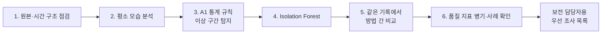

# 🔥 열처리 공정 솔트조 온도 이상 구간 탐지

> **솔트조 온도 이상 구간을 찾아 작업별 우선 조사 구간을 선별하는 설비 데이터 분석 프로젝트**  
> 2조 · KAMP 열처리 품질보증 AI 데이터셋 · 2026 설비 이상 예측 데이터 분석 팀 프로젝트


---

## 📌 한눈에 보기

| 데이터 | 주 분석 대상 | 분석 목적 | 최종 활용 |
|---|---|---|---|
| 2,939,722행 · 136작업 · 2022.01~07 | 솔트조 온도 1·2 Zone | 평소와 다른 온도 구간 탐지 | 담당자가 먼저 확인할 작업·시간대 제시 |
| 원본 초 단위 기록 | 소입로 1~4 Zone은 비교 대상 | A1 통계 규칙 vs Isolation Forest 비교 | 사후 조사 우선순위 지원 |

> **중요:** 이 프로젝트의 `이상`은 실제 고장 확정이 아니라 **조사 후보**입니다.  
> 데이터에 실제 고장 시각·설정 온도·허용 오차가 없기 때문에 탐지 정확도를 과장하지 않고, 서로 다른 방법이 같은 시간대를 얼마나 함께/따로 지목하는지 비교합니다.

---

## 🎯 문제 정의

열처리 공정에는 작업마다 수만 행의 초 단위 기록이 쌓이지만, 제공 데이터에는 공식 경보 기준이나 실제 고장 발생 시점이 없습니다.

따라서 프로젝트의 질문을 다음처럼 정의했습니다.

> **“방대한 온도 기록에서 담당자가 먼저 확인해야 할 작업과 시간대를 자동으로 좁힐 수 있는가?”**

초기에는 온도 이상과 불량률의 직접 관계를 분석하려 했지만, 품질 데이터가 작업 단위 합계만 제공되어 **불량이 발생한 시각·설비·Zone을 연결할 수 없었습니다.**  
이에 최종 목적을 **고장 예측 자체보다 ‘이상 후보 탐지 → 조사 우선순위 지원’**으로 재정의했습니다.

---

## 🧭 분석 흐름



### 시간순 데이터 사용


6~7월은 이전 탐색에서 이미 확인한 기간이므로 **독립 검증이 아니라 탐색적·회고적 비교**로 해석합니다.

---

## 🗂 데이터

| 항목 | 내용 |
|---|---|
| 출처 | [KAMP 열처리 품질보증 AI 데이터셋](https://www.kamp-ai.kr/aidataDetail?DATASET_SEQ=60) |
| 원본 공정 데이터 | `data.csv` · cp949 · 약 540MB · 2,939,722행 × 21열 |
| 기간 | 2022-01-03 11:22:07 ~ 2022-07-19 19:08:59 |
| 작업 수 | 배정번호 136개 |
| 주 분석 | `솔트조 온도 1 Zone`, `솔트조 온도 2 Zone` |
| 비교 분석 | `소입로 온도 1~4 Zone` |
| 품질 데이터 | 작업별 총수량·불량수량 등 136행 |
| 원본 공개 | KAMP 이용 조건 및 파일 용량 때문에 저장소에 포함하지 않음 |

### 데이터 품질 확인

- 완전 중복 추가 행: **0**
- 작업 내부 시간 역전: **0**
- 동일 작업·동일 시각 중복: **0**
- 숫자 변환 실패: **0**
- 기록 간격: 1초 **2,877,840건**, 2초 **61,643건**
- 60초 초과 긴 공백: **3곳** — 122초 / 160초 / 1,441초
- 결측은 임의 보간하지 않고 **판정 불가**로 분리

---

## 🔎 핵심 방법

### A1 — 직전 10분과 비교하는 통계 규칙

A1은 현재 온도를 같은 작업의 **직전 10분 중앙값**과 비교합니다.

이상 후보는 아래 조건을 함께 만족할 때 표시합니다.

1. 직전 10분 대비 차이가 1~4월의 평소 흔들림(`1.4826 × MAD`)의 **4배 이상**
2. 솔트조 실제 온도 차이가 **0.3℃ 이상**
3. 후보 기록 간격이 **2초 이하**면 같은 흐름으로 연결
4. 해당 상태가 **60초 이상** 지속

`MAD`는 중앙값 기준의 흔들림 크기로, 큰 값 몇 개에 표준편차보다 덜 영향을 받습니다.

### Isolation Forest — 시계열 특성을 함께 보는 머신러닝

각 Zone에 대해 다음 4개 특성을 사용합니다.

- 현재 온도
- 직전 10분 중앙값과의 차이
- 직전 5분 표준편차
- 초당 변화량

1~4월 기록으로 Isolation Forest를 학습하고, 5월에서 후보 기준 99% / 99.5% / 99.9%를 비교한 뒤 **99.9% 기준을 고정**하여 6~7월에 적용했습니다.

---

## 📊 핵심 결과

### 6~7월 공통 비교 범위

| 지표 | 값 |
|---|---:|
| 작업 수 | **36작업** |
| A1·IF 공통 판정 가능 기록 | **770,509개** |
| A1 이상 기록 | **590개 (0.077%)** |
| IF 이상 기록 | **828개 (0.107%)** |
| 두 방법 공통 기록 | **178개** |
| A1 설비 구간 | **6개 / 5작업** |
| IF 설비 구간 | **5개 / 4작업** |
| 시간대가 겹친 설비 구간 | **2개** |
| 최종 우선 조사 목록 | **7작업 · 9곳** |

### 해석

- **A1**은 같은 작업의 직전 상태에서 갑자기 벗어나는 변화에 민감했습니다.
- **IF**는 드문 온도 수준, 흔들림, 변화량의 조합에 반응했습니다.
- 두 방법이 함께 지목한 구간은 **139116, 139417** 두 곳입니다.
- 공통 구간을 먼저 확인하고, 한 방법만 지목한 구간을 다음 순서로 확인하는 **조사 우선순위**를 제안했습니다.

> 공통이라고 실제 고장인 것은 아니며, 한 방법만 지목했다고 오탐인 것도 아닙니다.

---

## 🏭 보전 관점의 활용

```text
작업 종료
   ↓
A1 + Isolation Forest 계산
   ↓
① 두 방법이 함께 지목한 시간대 우선 확인
   ↓
② 한 방법만 지목한 시간대 확인
   ↓
정비 기록·작업 일지·현장 상태와 대조
   ↓
원인이 확인되면 향후 정답 데이터로 축적
```

이 프로젝트가 직접 제공하는 것은 **고장 확정**이 아니라, 담당자가 294만 행 전체를 보는 대신 **몇 개의 작업·시간대부터 확인할지 좁혀 주는 목록**입니다.

---

## 🧪 함께 검토한 다른 접근

| 접근 | 확인한 내용 | 판단 |
|---|---|---|
| A2 고정 기준 | 1~4월 전체 대표 온도와 비교 | 1월의 다른 운전 수준까지 이상으로 잡는 한계 |
| Boxplot IQR | 작업별 1.5×IQR 기준 | 후보 **26,536기록(3.44%)**, 설비 **64구간**으로 조사 목록용으로는 과다 |
| XGBoost 품질 분류 | 1~5월 학습 → 6~7월 평가 | 위험 **7작업 중 1개** 탐지, 정확도 **0.67·0.69**로 전부 ‘안정’ 기준선 **0.81**보다 낮아 주 결과로 채택하지 않음 |
| 월별 이상·불량 표기 | 이상 지표와 월 불량률을 나란히 표시 | 관계를 주장하지 않고 참고 자료로만 사용 |

분석에서 원하는 결론이 나오지 않은 방법도 삭제하지 않고 **왜 주 결과로 쓰지 않았는지** 남겼습니다.

---

## ⚠️ 한계

1. 실제 고장·이상 시각이 없어 Precision / Recall / F1로 온도 이상 탐지 성능을 평가할 수 없습니다.
2. 설정 온도·허용 오차가 없어 A1의 `4배·0.3℃·60초`는 현장 규격이 아닌 분석용 운영 규칙입니다.
3. 품질 데이터가 작업 합계 한 줄이라 이상 구간과 불량 발생 시점을 직접 연결할 수 없습니다.
4. 6~7월은 이전 탐색에서 이미 본 기간이므로 완전히 새로운 독립 테스트가 아닙니다.
5. 제품 코드, 정비 기록, 경보 기록 등이 없어 탐지 구간의 물리적 원인을 확정하지 않습니다.

### 다음에 추가되면 좋은 데이터

- 설정 온도·허용 오차
- 고장·정비·경보 시각
- 제품/로트 조건
- 검사 시각과 불량 유형
- 더 긴 기간의 새로운 데이터

---

## 📁 공개 저장소 구성

이 GitHub에는 **재현에 필요한 최종 코드와 설명 문서 중심**으로 올립니다.  
원본 데이터, 대용량 중간 결과, 팀 내부 검토 기록은 포함하지 않습니다.

```text
.
├─ README.md
├─ 실행가이드.md        ← 실행 방법(빠른 확인·전체 재현)
├─ requirements.txt
├─ data/
│  └─ raw/
│     └─ README.md
├─ src/
│  ├─ data_contract.py
│  ├─ project_config.py
│  └─ env_check.py
├─ inputs/              ← XGBoost 품질 예측 입력(작업 요약 캐시)
├─ stages/
│  ├─ 1단계_전처리/
│  ├─ 2단계_평소모습/
│  ├─ 3단계_이상구간/
│  ├─ 4단계_머신러닝/
│  ├─ 5단계_평가/
│  └─ 6단계_품질표기/
├─ reports/             ← 보고서 숫자를 만든 3~5단계 실행 결과
├─ assets/
│  └─ 핵심 결과 그림
└─ docs/
   └─ 최종 보고서·발표 자료
```

각 단계 폴더의 `README.md`에는 **코드 목적 → 방법 선택 이유 → 결과 확인 방법 → 다음 단계와의 연결**을 설명합니다.

---

## ▶️ 실행 개요

> 📘 **자세한 실행 방법·기대 숫자·재현 확인 기록은 [`실행가이드.md`](실행가이드.md)를 보세요.** 원본을 넣은 뒤 약 2분이면 핵심 결과를 다시 계산해 볼 수 있습니다(실행가이드 3-0).

### 1. 환경

```powershell
py -3.12 -m venv .venv
.\.venv\Scripts\python.exe -m pip install -r requirements.txt
```

### 2. 데이터

원본 데이터는 GitHub에 포함하지 않습니다.  
`data/raw/README.md`의 안내에 따라 원본 파일을 `data/raw/`에 배치합니다.

### 3. 실행

단계별 실행 방법은 각 `stages/*/README.md`에서 확인할 수 있습니다.

```text
1단계 전처리
→ 2단계 평소 모습
→ 3단계 이상 구간
→ 4단계 Isolation Forest
→ 5단계 방법 비교·평가
→ 6단계 품질 표기·사례 확인
```

---

## 📦 프로젝트 진행 상태 — 2026-10-19

| 항목 | 상태 |
|---|---|
| 문제 정의 | ✅ 확정 |
| 원본·시계열 점검 | ✅ 완료 |
| 평소 모습 분석 | ✅ 완료 |
| A1·A2 이상 구간 | ✅ 완료 |
| Isolation Forest | ✅ 완료 |
| 방법 비교·대안 분석 | ✅ 핵심 수치 확정 · 코드 최종 검수 중 |
| 품질 표기·사례 확인 | ✅ 완료 |
| 문제정의서 | ✅ 제출 준비 완료 |
| 결과보고서 | 🟡 작성 중 |
| 발표 자료 | 🟡 제작 예정 |
| 최종 코드 패키지 | 🟡 최종 실행 확인 후 확정 |

---

## 👥 Team 2

| 담당 | 팀원 |
|---|---|
| 팀장·일정·협의, 데이터 전처리, 이상 기준(3단계), 문서·발표 | **남정곤** |
| 시계열 분석(2단계), 머신러닝(4단계) | 강승민 |
| 머신러닝(4단계), 품질 예측(XGBoost) | 최정후 |
| 평가(5단계), 발표 영상·3D 공정 그림 | 김동형 |
| 품질 연결(6단계) | 김도진 |
| 문제 정의, 데이터 시각화 | 팀원 전체 |

---

## 💡 프로젝트에서 중요하게 본 원칙

> **무엇을 했는가 → 왜 했는가 → 결과가 무엇을 의미하는가 → 무엇은 말할 수 없는가**

모델 성능 숫자를 만드는 것보다, 데이터의 한계를 인정하면서도 현장 담당자가 실제로 사용할 수 있는 **조사 우선순위**를 만드는 데 초점을 두었습니다.


---

## 📚 데이터 출처 표기

중소벤처기업부, Korea AI Manufacturing Platform(KAMP), **열처리 품질보증 AI 데이터셋**, 스마트제조혁신추진단(수행기관: ㈜임픽스), 2022.12.23.  
https://www.kamp-ai.kr/aidataDetail?DATASET_SEQ=60

> 원본 데이터는 약 540MB이며 KAMP 이용 조건에 따라 GitHub 저장소에는 포함하지 않습니다.
